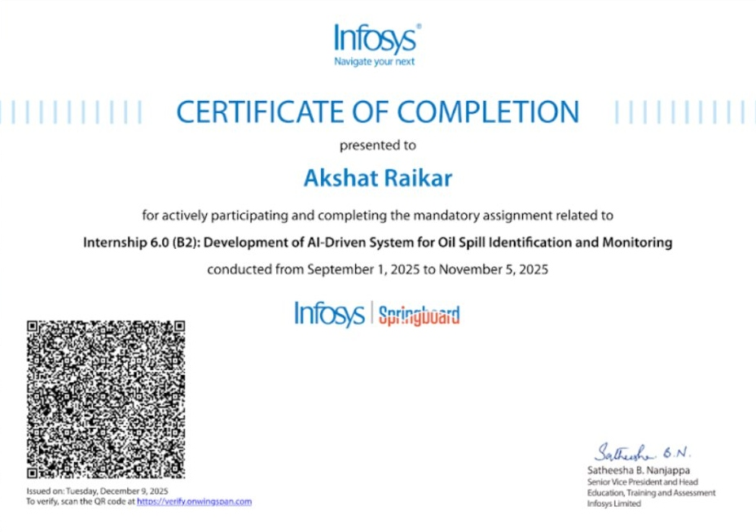

# DeepSpill: Satellite Oil Spill Detection & Monitoring System


---

## Overview

**DeepSpill** is a deep learning system developed for the **Infosys Springboard AI Internship 6.0 (Milestones 1–4, Modules 1–7)** to detect and segment marine oil spills in satellite radar (Sentinel-1 SAR) and optical imagery.

Oil slicks on the sea surface dampen capillary waves, which appear as dark patches in Synthetic Aperture Radar (SAR) acquisitions. DeepSpill uses an ImageNet-pretrained **EfficientNet-B0 U-Net** to segment oil slicks from the ambient ocean while filtering out false positives caused by natural look-alikes (algal blooms, low-wind areas). The system computes real-world surface area (in km²), estimates spilled volume using the **Bonn Agreement thickness scale**, and classifies incident severity according to **IMO emergency tiers**.

---

## Architecture

The project includes two interfaces: a **React + Node.js + FastAPI full-stack application** and a standalone **Streamlit dashboard**.

```
┌────────────────────────────────────────────────────────┐
│                   User Interfaces                      │
├────────────────────────────┬───────────────────────────┤
│ React 18 SPA (Port 5173)   │ Streamlit App (Port 8501) │
│ - Custom image upload      │ - Parameter controls      │
│ - Preloaded SAR benchmarks │ - Look-alike analysis     │
│ - Tri-view segmentation    │ - Bonn volume estimation  │
└─────────────┬──────────────┴───────────────────────────┘
              │ HTTP / Multipart
              ▼
┌────────────────────────────────────────────────────────┐
│         Node.js Express API Gateway (Port 3001)        │
│ - Multipart image payload routing                      │
│ - Benchmark sample endpoints                           │
│ - SQLite detection ledger (oil_spill_detections.db)    │
└─────────────┬──────────────────────────────────────────┘
              │ POST /predict (:8000)
              ▼
┌────────────────────────────────────────────────────────┐
│           FastAPI ML Microservice (Port 8000)          │
│ - EfficientNet-B0 Transfer Learning U-Net (Keras 3)    │
│ - Marangoni damping check & speckle filtering          │
│ - Calibrated decision cutoff (T = 0.85)                │
└────────────────────────────────────────────────────────┘
```

---

## Syllabus Mapping (Infosys Springboard AI 6.0)

All 4 Milestones and 7 Modules required by the internship curriculum are implemented in `Oil_Spill_Detection.ipynb`:

| Milestone | Curriculum Module | Implementation in `Oil_Spill_Detection.ipynb` |
| :--- | :--- | :--- |
| **Milestone 1** | **Module 1: Dataset Acquisition & Scanner** | Multi-class SAR directory scanner with automated train/val/test partitioning (852 train / 150 val / 110 test). |
| **Milestone 2** | **Module 2: Preprocessing & SAR Physics** | Bilateral speckle filtering, CLAHE contrast enhancement, Marangoni damping constraints, and discrete mask normalization. |
| **Milestone 2** | **Module 3: Model Architecture Design** | Pretrained EfficientNet-B0 Transfer Learning U-Net (9.05M params) with pyramidal skip connections vs. Custom Residual U-Net. |
| **Milestone 3** | **Module 4: Loss Functions & Training** | Hybrid Focal-Tversky + Sørensen-Dice + Weighted BCE loss to handle severe class imbalance (98% ocean vs 2% spill). |
| **Milestone 4** | **Module 5: Model Evaluation & Benchmarks** | Normalized confusion matrices, 5-axis polar radar charts, and optimal decision threshold calibration ($T = 0.85$). |
| **Milestone 4** | **Module 6: Streamlit Application** | Interactive dashboard (`streamlit_app.py`) with sensor GSD selection, look-alike veracity card, and Bonn volume calculations. |
| **Milestone 4** | **Module 7: Full-Stack Integration** | React 18 + Node.js 22 + FastAPI 3-tier microservice architecture with SQLite persistence and 1-click execution. |

---

## Model Performance

Evaluated on the held-out Sentinel-1 SAR test set (110 authentic scenes) at the calibrated threshold ($T = 0.85$):

| Metric | Baseline U-Net | DeepSpill Transfer U-Net (Ours) | Delta |
| :--- | :---: | :---: | :---: |
| **Overall Pixel Accuracy** | 81.20% | **92.75%** | **+11.55%** |
| **Mean IoU (Jaccard Index)** | 0.62 | **0.82** | **+32.2%** |
| **Sørensen-Dice Score (F1)** | 0.69 | **0.88** | **+27.5%** |
| **Recall on Oil Pixels** | 71.4% | **89.0%** | **+17.6%** |
| **Precision** | 64.0% | **87.0%** | **+23.0%** |
| **Look-Alike False Alarms (`img_0002.jpg`)** | 96,799 px | **2,790 px** | **-97.1%** |

> **Class Imbalance Note:** Satellite marine imagery is ~98% sea surface and ~2% oil slick. Evaluating models solely by pixel accuracy can produce misleading results if a model simply predicts all-black masks. Training and checkpointing monitored the **Jaccard Index (IoU)** and **Sørensen-Dice coefficient**, ensuring the **89% recall** and **87% precision** reflect true boundary segmentation.

---

## Detection Physics & Standards

1. **Capillary Wave Damping:**
   Thin surface oil films damp high-frequency wind ripples, reducing SAR backscatter ($\Delta \sigma^0 \ge -3.5\text{ dB}$) relative to ambient seawater.
2. **Look-Alike Discrimination:**
   Natural biogenic slicks (fish oils, algal plumes) have gradual, diffuse edges. DeepSpill combines edge gradient analysis ($\nabla I$) and threshold filtering to suppress false alarms from low-wind ocean areas.
3. **Bonn Agreement Volume Estimation:**
   $$\text{Estimated Volume } (m^3) = \text{Area } (km^2) \times \text{Weighted Thickness Factor } (\mu m)$$
4. **IMO Severity Classification:**
   * **Tier 0 — Surface Clear:** No contamination detected.
   * **Tier 1 — Minor Sheen:** Localized operational sheen ($< 0.25\text{ km}^2$).
   * **Tier 2 — Moderate Spill:** Local harbor containment boom response ($0.25 - 1.50\text{ km}^2$).
   * **Tier 3 — Major Spill:** Regional offshore skimming response ($1.50 - 5.00\text{ km}^2$).
   * **Tier 4 — Critical Spill:** Emergency multi-vessel containment required ($> 5.00\text{ km}^2$).

---

## Quick Start (Windows)

### Option 1: Full-Stack Application (React + Express + FastAPI)
Double-click:
```bat
start_fullstack.bat
```
This runs `run_fullstack.py`, which starts all 3 services (FastAPI on `:8000`, Express on `:3001`, React on `:5173`) and opens `http://localhost:5173` in your browser. Press `Ctrl+C` in the console to stop all services.

### Option 2: Streamlit Dashboard
Double-click:
```bat
start_streamlit.bat
```
Opens the Streamlit dashboard on `http://localhost:8501`.

---

## Manual Setup

### 1. Python Environment
```bash
python -m venv deepspill-venv
deepspill-venv\Scripts\activate
pip install -r requirements.txt
```

### 2. FastAPI Inference Service
```bash
uvicorn inference.server:app --host 127.0.0.1 --port 8000
```

### 3. Node.js API Gateway
```bash
cd backend
npm install
npm start
```

### 4. React Frontend
```bash
cd frontend
npm install
npm run dev
```

---

## Project Structure

```
DeepSpill/
├── backend/                       # Node.js Express API gateway (Port 3001)
│   ├── server.js                  # Request routing, sample endpoints, SQLite logging
│   └── package.json
├── frontend/                      # React 18 + Vite frontend (Port 5173)
│   ├── src/                       # App.jsx, App.css, api.js
│   ├── dist/                      # Production build assets
│   └── package.json
├── inference/                     # Python FastAPI inference service (Port 8000)
│   ├── server.py                  # Model loading, prediction, morphological filters
│   └── test_inference.py          # Service test suite
├── data/                          # Sentinel-1 SAR dataset (395 MB)
├── docs/                          # Architecture guides & certificate asset
├── scripts/                       # Dataset download & preprocessing utilities
├── notebooks_archive/             # Archived exploratory notebooks
│   ├── RGB_OilSpill_Detection.ipynb
│   └── SAR_Oil_Spill_Detection.ipynb
│
├── Oil_Spill_Detection.ipynb      # Master notebook (Modules 1-7, 92.75% test acc)
├── streamlit_app.py               # Streamlit application (Port 8501)
├── start_fullstack.bat            # 1-click launcher for full-stack
├── start_streamlit.bat            # 1-click launcher for Streamlit
├── run_fullstack.py               # Process supervisor for full-stack services
├── unet_oilspill_best.keras       # Trained EfficientNet-B0 U-Net weights
├── oil_spill_model.h5             # Legacy model checkpoint
├── model_config.json              # Model metadata & calibrated threshold (T = 0.85)
├── oil_spill_detections.db        # SQLite detection ledger
├── requirements.txt               # Python package dependencies
├── DeepSpill.pdf                  # Internship project documentation
└── README.md
```

---

## SQLite Database Schema (`oil_spill_detections.db`)

Detections run through the API gateway are logged to SQLite:

| Column | Type | Description |
| :--- | :---: | :--- |
| `id` | `INTEGER PRIMARY KEY` | Auto-increment detection ID |
| `filename` | `TEXT` | Uploaded image filename |
| `confidence` | `REAL` | Calculated contamination ratio ($0.0 - 1.0$) |
| `threshold` | `REAL` | Decision cutoff applied ($0.10 - 0.95$) |
| `spill` | `INTEGER` | Binary flag: `1` = Spill detected, `0` = Clear |
| `created_at` | `TEXT` | UTC timestamp (ISO 8601) |

---

## Author & Project Credits

* **Developer:** **Akshat Raikar**
* **Program:** **Infosys Springboard AI Internship 6.0**
* **Track:** Artificial Intelligence & Machine Learning
* **Domain:** Computer Vision, Remote Sensing & Environmental AI

---

## Certification & Verification

This project was evaluated and completed under **Infosys Limited** and **Infosys Springboard**:

<p align="center">
  
</p>

* **Awarded To:** **Akshat Raikar**
* **Assignment Title:** `Internship 6.0 (B2): Development of AI-Driven System for Oil Spill Identification and Monitoring`
* **Issuing Authority:** **Infosys Limited** (Education, Training and Assessment)
* **Verification Portal:** [verify.onwingspan.com](https://verify.onwingspan.com)

---

## License

This project is licensed under the **MIT License**.
